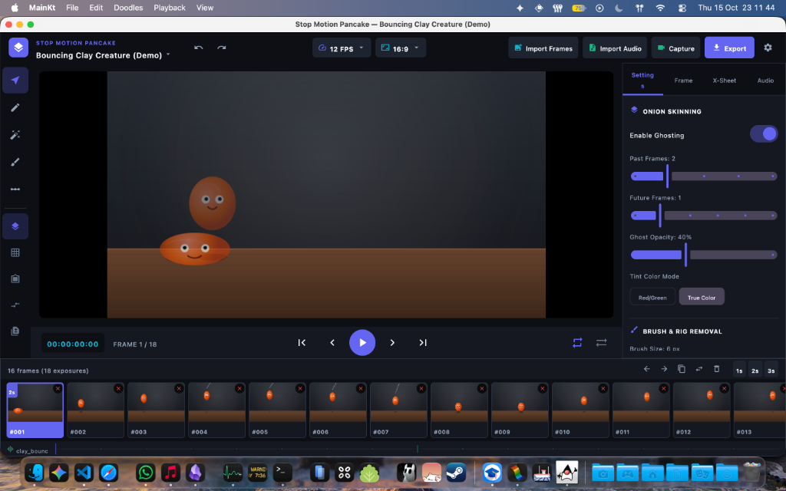

# stop motion pancake

a desktop app for making stop motion animations with doodle rotoscoping, continuity camera support and timeline tools



## quick start

run the app
```bash
./gradlew run
```

build the mac app and dmg
```bash
./gradlew createDistributable packageDmg
```

outputs end up in
- `build/compose/binaries/main/app/Stop Motion Pancake.app`
- `build/compose/binaries/main/dmg/Stop Motion Pancake-1.0.0.dmg`

## what it does

- capture stills from mac webcams and iphone continuity camera
- spacebar snaps frames in capture dialog
- live onion skinning over camera feed and in editor
- doodle studio with glow, chalk, pen, speed trails and stamps
- copy doodles to next frame to animate drawn elements
- audio scrubbing for dialogue lip sync with exposure sheet
- frame holds on 1s, 2s or 3s
- quick frame deletion with backspace or trash button
- color themes with live preview in settings
- export to mp4, gif or image zip sequences

## shortcuts

- space: play or pause in editor, snap frame in camera capture
- left / right: step frames
- backspace / delete: delete frame
- cmd z / cmd shift z: undo / redo
- cmd d: duplicate frame
- cmd shift d: copy doodles to next frame
- o: toggle onion skin
- b: doodle pen
- c: camera capture
- cmd comma: preferences and themes
- cmd e: export
