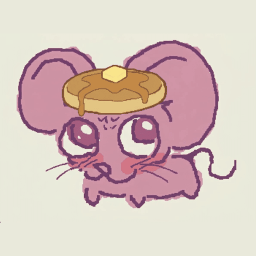

<div align="center">

  

  # Stop Motion Pancake

  **A modern desktop studio for stop-motion animation, mixed-media rotoscoping, and frame-accurate audio sync.**

  [](https://kotlinlang.org/)
  [](https://www.jetbrains.com/lp/compose-multiplatform/)
  []()
  [](LICENSE)

  <br />

  

</div>

---

## Overview

**Stop Motion Pancake** combines traditional frame-by-frame animation workflows with digital rotoscoping tools. Designed for claymation, paper cutout, and mixed-media creators, it pairs low-latency tethered camera capture with real-time vector doodles, frame-accurate audio scrubbing, and multi-format video export.

---

## Key Features

### Tethered Capture Studio
* **Apple Continuity Camera & Webcam Support:** Wirelessly capture high-resolution stills from your iPhone or tethered USB webcams.
* **Instant Viewfinder Buffer:** Snap frames with zero shutter delay directly into your timeline without interrupting the camera feed.
* **Intervalometer & Countdown:** Automated time-lapse capture and customizable 3-second self-timers for hands-free puppet adjustment.
* **Camera Onion Skinning:** Live ghost overlay against your previous frame directly inside the viewfinder.

### Doodle Studio & Vector Rotoscoping
* **Stylized Brushes:** Draw over frames using **Solid Pen**, **Neon Glow**, **Sketch Chalk**, and **Dashed Speed Trails**.
* **Shape Stamps:** Quick-stamp stars, lightning bolts, hearts, and speed lines.
* **Stroke Eraser:** Interactive vector eraser that cleanly removes intersecting lines without touching the underlying photo.
* **Live Timeline Mirroring:** Bottom filmstrip thumbnails reflect hand-drawn strokes in real time as your pen moves.
* **Frame Propagation:** Duplicate or cascade drawings across adjacent frames with `Cmd + Shift + D`.

### Viewport & Composition Tools
* **Multi-Aspect Ratio Canvas:** Seamlessly animate in **16:9 Widescreen**, **9:16 Vertical (Reels/Shorts)**, **4:3 Classic TV**, **1:1 Square**, or **2.39:1 Cinematic**.
* **Infinite Pan & Zoom:** Zoom up to 500% with `Cmd +` / `Cmd -`. Pan across the frame by holding `Spacebar` + dragging, using the Hand tool (`H`), or scrolling with a two-finger trackpad swipe.
* **Multi-Layer Onion Skinning:** Configure past (red tint) and future (green tint) ghost frames with independent opacity controls.
* **Doodles-Only Ghosting:** Ghost only vector drawings to keep the photographic stage clean and unobstructed.
* **Diagnostic Modes:** Difference/flicker detection and interactive split-screen frame comparison.

### ⏱Timeline, Exposure & Audio Sync
* **Exposure Beats (Holds):** Animate on **1s**, **2s**, or **3s** with exposure multipliers.
* **Batch Operations:** Reverse sequences, duplicate frames, multi-select, and reorder on the fly.
* **Frame-Accurate Audio Scrubbing:** Scrub PCM audio waveforms frame-by-frame for precise lip-syncing.
* **Digital X-Sheet (Dope Sheet):** Dedicated exposure sheet for phonemes, camera notes, and key action cues.

### File Management & Export
* **Custom Project Workspaces:** Choose your own default folder for new animations, autosaves, and camera captures.
* **High-Quality Export Formats:**
  * **MP4 Video:** H.264 video with AAC audio synchronization.
  * **Animated GIF:** Two-pass palette generation with Bayer dithering.
  * **PNG Sequence:** Numbered, zero-compression `.zip` archives.

---


## Keyboard Shortcuts

| Category | Shortcut | Action |
| :--- | :--- | :--- |
| **Playback** | `Spacebar` | Play / Pause animation |
| | `Left Arrow` / `Right Arrow` | Step backward / forward 1 frame |
| | `Home` / `End` | Jump to start / end of timeline |
| **Editing** | `Cmd + Z` / `Cmd + Shift + Z` | Undo / Redo |
| | `Cmd + D` | Duplicate selected frame |
| | `Backspace` / `Delete` | Delete selected frame(s) |
| | `Cmd + N` | New Project (in default workspace) |
| | `Cmd + S` / `Cmd + Shift + S` | Save Project / Save As |
| **Doodles** | `B` | Activate Doodle Pen tool |
| | `E` | Activate Eraser tool |
| | `Cmd + Shift + D` | Copy doodles to the next frame |
| **Viewport** | `Spacebar (Hold) + Drag` | Pan canvas |
| | `H` | Hand / Pan tool |
| | `Cmd + =` / `Cmd + -` | Zoom in / Zoom out |
| | `Cmd + 0` | Reset zoom and center frame |
| | `O` | Toggle Onion Skinning on / off |
| **Tools** | `C` | Open Camera Capture Studio |
| | `Enter` / `Spacebar` *(in Capture)* | Snap photo frame |
| | `Cmd + ,` | Preferences, workspace paths & themes |
| | `Cmd + E` | Export dialog (MP4 / GIF / ZIP) |

*(On Windows / Linux, use `Ctrl` in place of `Cmd`)*

---

## Studio Themes

Stop Motion Pancake includes 6 built-in color palettes tailored for dark studio environments:
* **Obsidian Indigo** *(Default)*: Deep slate canvas with electric indigo and cyan accents.
* **Cyber Cyan**: Pitch-black canvas with neon cyan and vivid magenta highlights.
* **Sunset Amber**: Warm analog charcoal with golden amber tones.
* **Emerald Studio**: Pine slate with vibrant mint and emerald highlights.
* **Neon Rose**: Midnight velvet with neon rose and violet accents.
* **Monochrome Slate**: Clean graphite with high-contrast neutral accents.

*Change your theme anytime in **Preferences (`Cmd + ,`) → Appearance & Themes**.*

---

## Tech Stack

* **UI Framework:** [Compose Multiplatform](https://www.jetbrains.com/lp/compose-multiplatform/) (Desktop / Skiko)
* **Language:** [Kotlin](https://kotlinlang.org/) (Coroutines, Serialization)
* **Video & Camera Engine:** [FFmpeg](https://ffmpeg.org/) (AVFoundation on macOS, DirectShow on Windows, V4L2 on Linux)
* **Audio Engine:** Java Sound API (16-bit PCM waveform generation and snippet scrubbing)

---

## Quick Start

### Prerequisites
* **Java 17+** (JDK)
* **FFmpeg** installed and accessible in your system `PATH` (used for hardware video capture and rendering)

### Run from Source
```bash
./gradlew run
```

### Build Native Installers
Package a standalone installer for your host operating system:

```bash
# macOS (.dmg)
./gradlew packageDmg

# Windows (.msi)
./gradlew packageMsi

# Linux (.deb)
./gradlew packageDeb

# Cross-platform Runnable Fat JAR
./gradlew packageUberJarForCurrentOS
```

* Installers output to: `build/compose/binaries/main/`
* Fat JAR outputs to: `build/compose/jars/`

